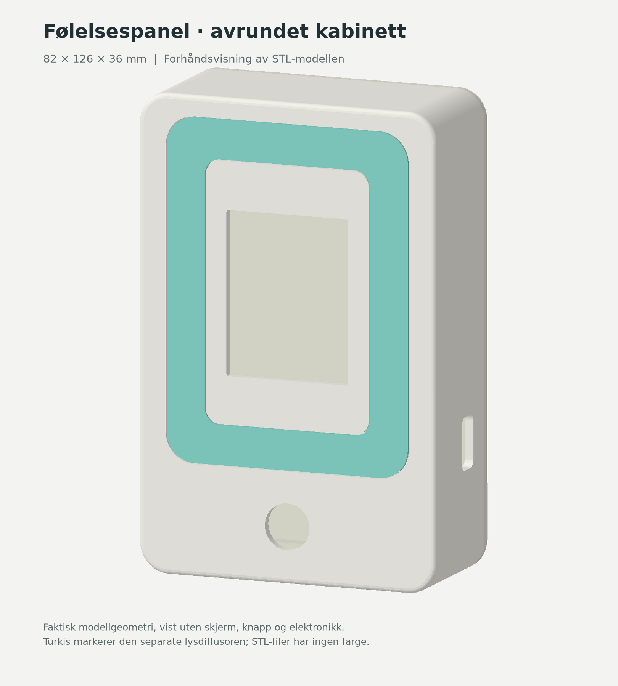
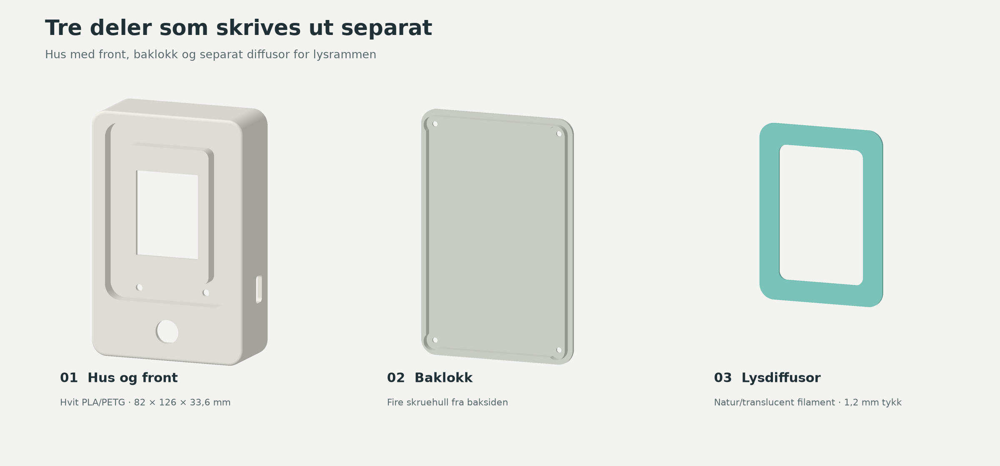

# Følelsespanel – avrundet ESP32-kabinett v3

3D-printbart kabinett med avrundede hjørner, skjulte bakskruer, knappåpning,
kabelåpning på høyre side og separat diffusor for en WS2812B-lysramme.

**[Last ned komplett STL-pakke fra utgivelsen v3.0.0](https://github.com/Ompalumpa89/Emotions/releases/tag/v3.0.0)**

## Deler som skrives ut

| Fil | Antall | Materiale |
| --- | --- | --- |
| [01_Hus_og_front.stl](01_Hus_og_front.stl) | 1 | Hvit PLA/PETG |
| [02_Baklokk.stl](02_Baklokk.stl) | 1 | Hvit PLA/PETG |
| [03_Lysdiffusor.stl](03_Lysdiffusor.stl) | 1 | Lysgjennomslippelig filament |
| [04_Provebit_knapp_og_passning.stl](04_Provebit_knapp_og_passning.stl) | 1 først | Prøve av knapp og passning |
| [05_Provebit_innlegg.stl](05_Provebit_innlegg.stl) | 1 først | Innlegg til prøvebiten |

## Mål og kompatibilitet

- Ferdig størrelse: **82 × 126 × 36 mm**.
- Skjermåpning: **33,5 × 43,5 mm**, stående.
- Skjermlomme: **41,5 × 66,5 mm**, basert på modul ca. 40 × 65 mm.
- Knapphull: **Ø 12,3 mm** for nominell 12 mm gjenge.
- LED-kanal: 11 mm bred på rette sider, beregnet på fire rette opptil 10 mm brede LED-segmenter.
- Diffusoren limes i flukt med fronten. Den har 0,25 mm klarering per side.
- Fire M2,5 × 8 mm selvskjærende plastskruer med senkhode holder baklokket.

**Prøvepassmodell:** Digitalt kontrollert, men ikke fysisk prøveprintet.
Kontroller den faktiske skjermen, knappen og kontaktene, og skriv ut prøvebitene først.
Det finnes flere ulike ST7789-moduler; skjermåpningen forutsetter sentrert aktivt område.

## Utskrift og montering

Skriv ut hus, baklokk og diffusor separat i levert orientering. Utgangspunkt:
0,20 mm lag, 3–4 vegger og 15–20 % infill; diffusoren med 100 % infill.
LED-kanalen krever brobygging over ca. 11–14 mm eller lokal støtte.
Skjerm og ESP32 festes med egnet montasjetape eller egne tilpassede fester.

Se [komplett veiledning med mål og montering](LES_MEG.md).

## Kilde og versjon

[generate_enclosure.py](generate_enclosure.py) inneholder justerbare mål.
[kontrollrapport.json](kontrollrapport.json) dokumenterer lukket geometri,
konsistente normaler og at delene ikke kolliderer digitalt.
[Sammenstilling_for_visning.glb](Sammenstilling_for_visning.glb) er til 3D-visning.

Dette er **kabinett v3**, etter det tidligere v2-kabinettet fra prosjektpakken på
Tuverud.com. Modellen er nykonstruert med lysramme og avrundet hus.
Arduino-koden for D1 mini i resten av repoet gjelder den tidligere OLED-varianten.

Se [endringsloggen](CHANGELOG.md).
