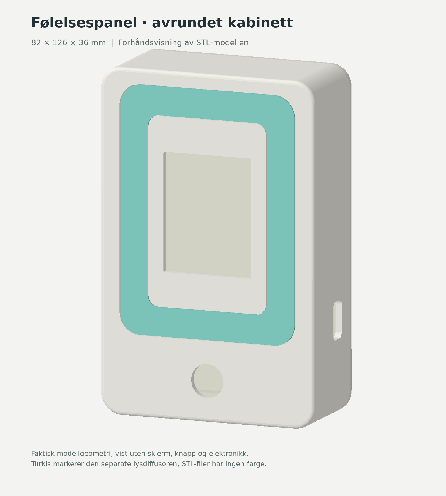

# Emotions – følelsespanel

Følelsespanel-prosjekter med knapp, skjerm og farget LED-lys.

## Nytt: ESP32-kabinett v3

Avrundet 3D-printbart kabinett med lysramme, skjulte bakskruer og separat diffusor.
Ferdig størrelse: **82 × 126 × 36 mm**.

**[Last ned STL-pakken – v3.0.0](https://github.com/Ompalumpa89/Emotions/releases/tag/v3.0.0)**

[](ESP32_kabinett_v3/README.md)

Se [STL-filer, mål og monteringsveiledning](ESP32_kabinett_v3/README.md).
Modellen er kontrollert digitalt, men er ikke fysisk prøveprintet.
Kontroller komponentmål og skriv ut prøvebitene først.

Kabinettet er laget for ESP32 med stående TFT-skjerm. Arduino-koden nedenfor
gjelder den tidligere D1 mini-varianten med OLED.

## Opprinnelig prosjekt: D1 mini, OLED og WS2812B

A small ESP8266/D1 mini project where the user selects an emotion with one button.

The OLED screen shows:
- The selected emotion
- A simple monochrome figure

The WS2812B LED strip changes color to match the selected emotion.

## Hardware

- LOLIN/WEMOS D1 mini or compatible ESP8266 board
- 128x64 I2C OLED display, address `0x3C`
- 1 push button
- WS2812B LED strip/module with 5 LEDs
- USB power

## Wiring

### OLED

| OLED | D1 mini |
|---|---|
| GND | G |
| VCC | 3V3 |
| SCL | D1 |
| SDA | D2 |

### Button

| Button | D1 mini |
|---|---|
| One side | D3 |
| Other side | G |

Do not hold the button while powering on or uploading code.

### WS2812B

| WS2812B | D1 mini |
|---|---|
| 5V | 5V |
| GND | G |
| DIN | D6 |

Recommended: place a 330 ohm resistor between D6 and DIN.

## Arduino libraries

Install these from Arduino IDE Library Manager:

- Adafruit SSD1306
- Adafruit GFX Library
- Adafruit NeoPixel

## Board settings

Use an ESP8266 board profile, for example:

```text
LOLIN(WEMOS) D1 R2 & mini
